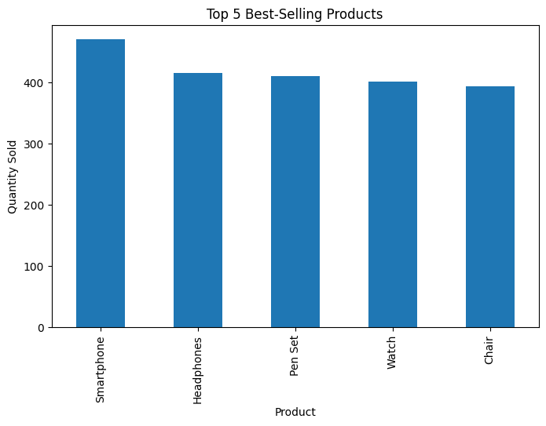
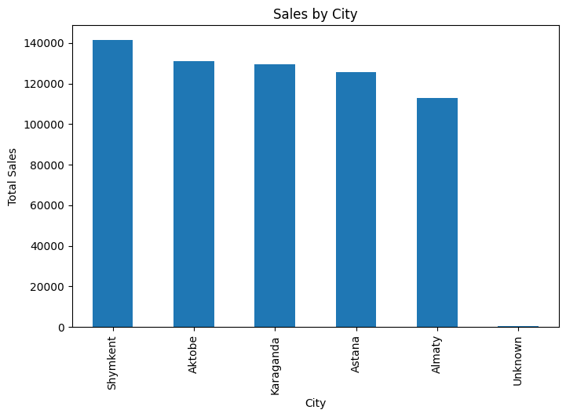
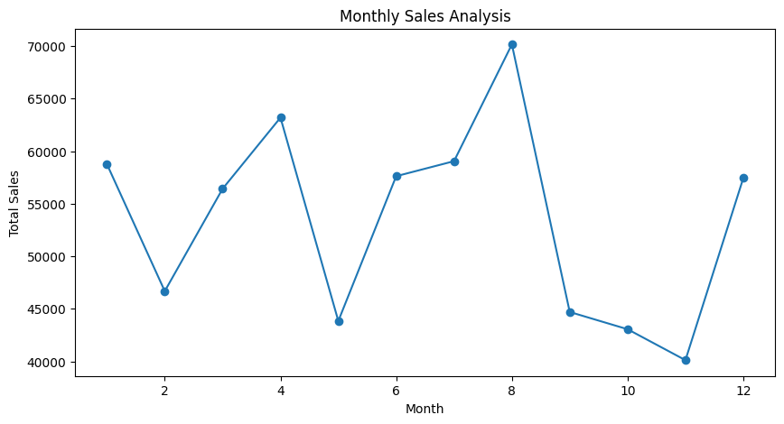

# Python Sales Data Analysis 📊

## Project Overview
This project analyzes online store sales data using Python. The goal is to identify sales trends, top-selling products, and business insights.

## Tools & Technologies
- Python
- Pandas
- Matplotlib
- Google Colab
- CSV

## Project Steps
1. Data loading and inspection
2. Data cleaning and preprocessing
3. Sales and profit calculations
4. Top 5 best-selling products analysis
5. Sales analysis by city
6. Monthly sales analysis
7. Data visualization
8. Business insights

## Visualizations

### Top 5 Best-Selling Products

### Sales by City

### Monthly Sales

## Project Files
- `python_sales_analysis.ipynb` — Python analysis notebook
- `cleaned_sales_data.csv` — cleaned dataset
- `analysis_report.txt` — analysis summary
- `top_products.png` — product sales chart
- `sales_by_city.png` — city sales chart
- `monthly_sales.png` — monthly sales chart

## Dataset
This project uses synthetic sample sales data created for educational and portfolio purposes.

## Author
Ernur-da

GitHub: https://github.com/Ernur-da
